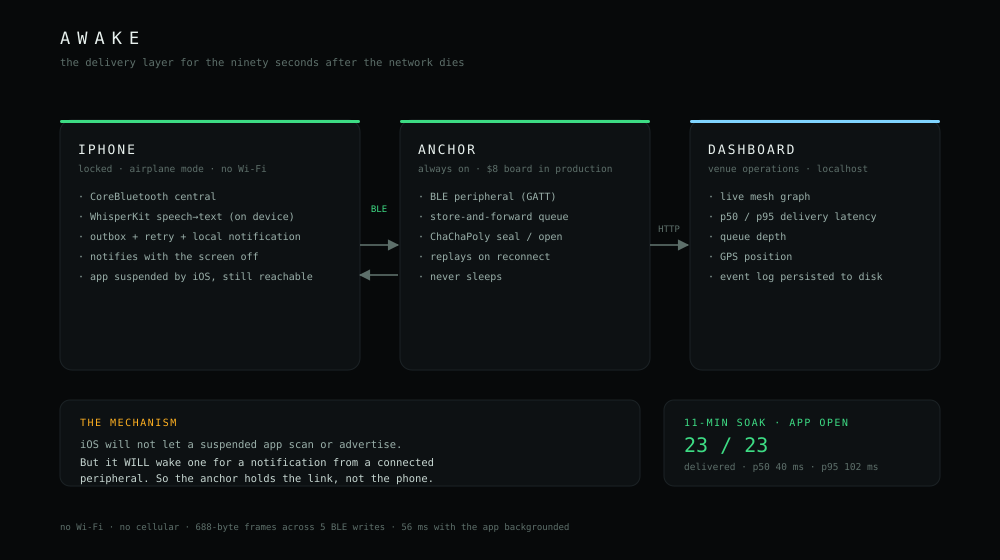
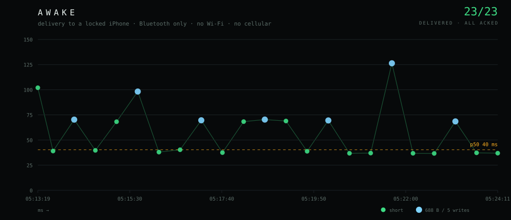

# AWAKE

**Offline messaging that actually reaches a locked phone.**

*The delivery layer for the ninety seconds after the network dies.*

---

## The problem

Every offline messenger works right up until you put your phone in your pocket.
Lock the screen and iOS suspends the app, so delivery stops — at precisely the
moment you need it. Concerts, stadiums, disasters, backcountry.

The alternatives all ask for something unreasonable:

- **Phone-to-phone apps** need both people to have the app open at the same time.
- **Wearables** (Totem Compass and similar) work well but require every attendee
  to buy and carry a dedicated device.
- **LoRa mesh** (Meshtastic, MeshCore) needs a radio per person and a hobbyist's
  patience.

None of them is something a venue can install and a stranger can use.

## What we built

A BLE messaging system where the **anchor** — not the phone — is the thing that
stays awake.

```
  iPhone (locked, airplane mode)
      │  BLE GATT: phone writes RX, anchor notifies TX
      ▼
  AWAKE-ANCHOR   (macOS app today, an $8 BLE board in production)
      │  local HTTP
      ▼
  operations dashboard: latency, queue depth, GPS
```

The phone is a client of an always-on anchor. Because a *connected* peripheral
can wake a suspended app, the phone receives, acknowledges and notifies while
the app is suspended or in the background. In production the anchor is venue
infrastructure — the crowd needs nothing but the app.



## Measured, not claimed

An 11-minute run with the app open, no Wi-Fi, no cellular:

```
probes sent       23
acks received     23
delivery rate     100%
p50 / p95 / max   40 / 102 / 126 ms
multi-chunk acks  7   (684–690 bytes, 5 BLE writes each)
long-message p50  70 ms
```

Those 23 were delivered with the app **in the foreground**. The lock-screen
claim rests on separate evidence: **56 ms** to a phone whose app was in the
background, and **84 s** for a message the anchor held while the phone was out
of range, then replayed and acknowledged while the app was inactive.



## Why it is novel

| | phones-only apps | Totem | Meshtastic | **Awake** |
|---|---|---|---|---|
| delivers to a locked phone | no | n/a (wearable) | partly | **56 ms, verified** |
| hardware per person | none | a Compass | a radio | **none** |
| who deploys | nobody | attendee buys | hobbyist | **the venue** |
| survives leaving range | no | no | yes | **yes, 84 s replay** |
| encrypted | varies | yes | yes | **ChaChaPoly** |
| delivery receipt | no | no | sometimes | **every message** |

The novelty is the **deployment model**, not the radio: treat an always-on
anchor as venue infrastructure, so attendees need no extra device and delivery
survives the phone being asleep.

## Engineering

- **Swift**, one `AwakeCore` package shared by both apps so they cannot drift
- **35 unit tests**, 0 failures — 93.4% line coverage of the core, clean under
  both ThreadSanitizer and AddressSanitizer: length-prefixed framing, 300
  randomised BLE chunkings, dedupe/TTL/queues, ChaChaPoly round trip and
  tamper rejection, stale-link detection
- **ChaChaPoly** body encryption; routing metadata stays visible (stated limit)
- **Store-and-forward** with TTL, retries, and per-node queues
- **Argmax WhisperKit** on-device speech→text; system TTS for playback
- **Zero-dependency Python** dashboard, event log persisted to disk
- One-command demo bootstrap, one-command verification

### Five bugs found by measurement

The first overnight run **failed**, and chasing it produced real fixes:

1. Anchor trusted a stale subscriber count → messages lost instead of queued.
2. A restored peripheral arrives *already connected*, so services were never
   rediscovered → radio permanently mute.
3. `allowsBackgroundLocationUpdates` set before authorization → crash at launch.
4. BLE startup tied to SwiftUI `onAppear` → never runs when launched while locked.
5. `knownNode` kept only in memory → store-and-forward lapsed on anchor restart.

## What is not done

- Multi-hop between anchors (single hop today)
- Forward-secret encryption — X3DH + Double Ratchet is the production design
- LoRa transport (the envelope is transport-agnostic; the seam is there)
- Surviving a force-quit, which needs AccessorySetupKit and a real accessory

We say these out loud rather than let a judge find them.

## Run it

```
./verify.sh     # 35 tests + both builds + dashboard health
./demo.sh       # clean start, Mac kept awake, phone relinks
./install.sh    # rebuild + reinstall on the phone
```

Docs: [README](README.md) · [pitch](PITCH.md) · [demo script](DEMO.md) ·
[protocol](PROTOCOL.md) · [results](RESULTS.md) ·
[troubleshooting](TROUBLESHOOTING.md)
